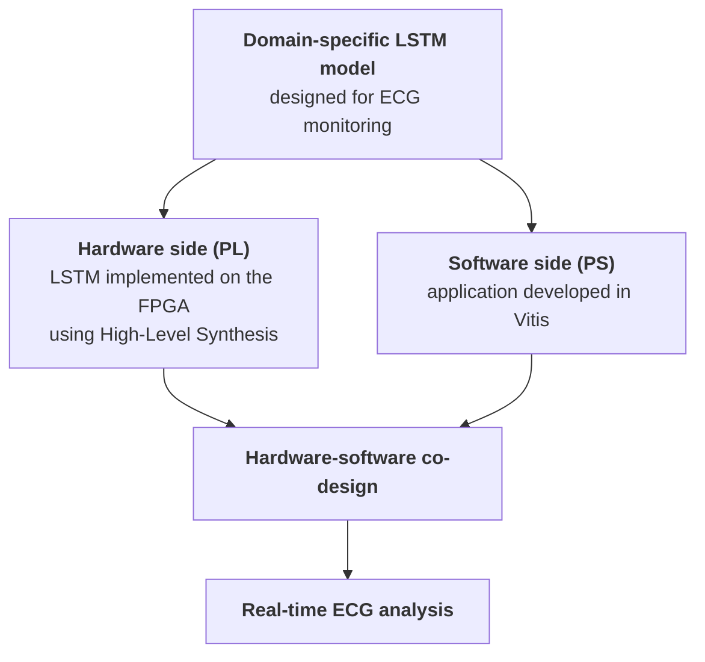

# ECG LSTM on FPGA

> Domain-specific LSTM model for ECG monitoring, implemented on an FPGA — final-year project.

> **Note:** this repository contains documentation only — an overview and the workflow of the project. Source code and design files are not included.

## Overview

A final-year project that brings deep learning to hardware: an **LSTM model designed for ECG monitoring** and implemented on an **FPGA** for real-time ECG analysis. The LSTM is implemented using **High-Level Synthesis (HLS)** for the programmable-logic (PL) part, and an application is developed in **Vitis** for the processing-system (PS) side — a hardware-software co-design.

## Workflow

## How it was built

1. **Model design** — an LSTM model designed for ECG monitoring.
2. **Hardware (PL)** — the LSTM implemented on the FPGA using High-Level Synthesis (HLS).
3. **Software (PS)** — an application developed in Vitis for the processing-system side.
4. **Co-design** — hardware and software designed together for real-time ECG analysis.

## Highlights

- Deep learning implemented directly in FPGA hardware, not only run in software.
- Hardware-software co-design across the programmable logic and the processing system.

## Context

Completed as a final-year project for a BS in Computer Engineering at NUTECH, as part of an internship at NECOP (National Electronics Complex of Pakistan).

## Stack

LSTM · High-Level Synthesis (HLS) · Vitis · FPGA (programmable logic + processing system)

---

More projects: [github.com/ALIKAZMI001](https://github.com/ALIKAZMI001)
